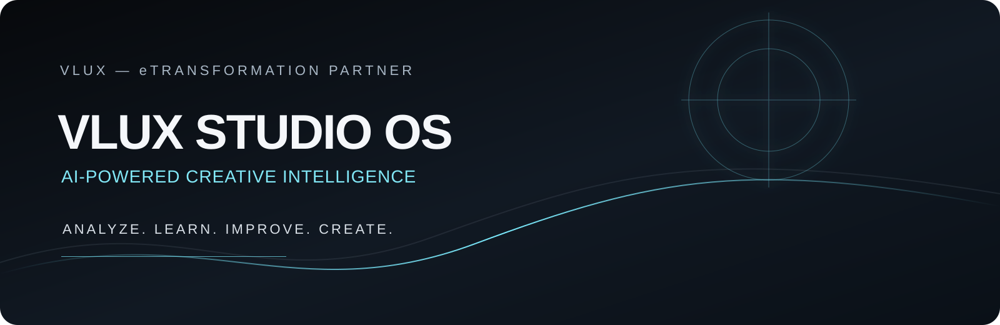
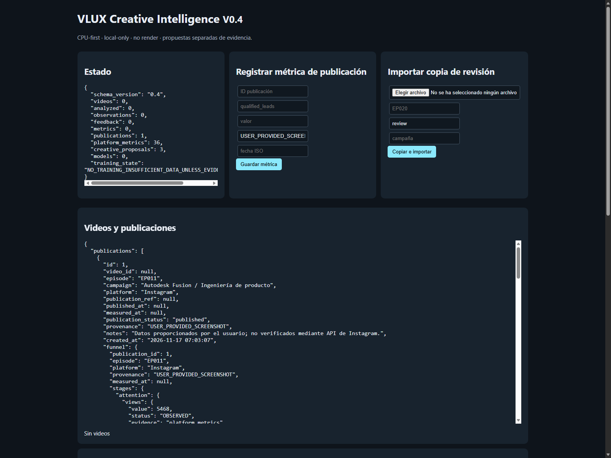

# VLUX Studio OS

**Inteligencia creativa para tomar mejores decisiones audiovisuales de negocio.**

<p>
  <a href="README.md">Read in English</a> ·
  <a href="https://vlux.com.mx">VLUX — eTransformation Partner</a>
</p>



VLUX Studio OS es una plataforma local para analizar videos, organizar evidencia, capturar preferencias humanas y convertir observaciones creativas en mejores decisiones de producción.

No afirma generar videos completos automáticamente. En V0.4 ayuda a distinguir qué es observable, qué es una hipótesis y qué conviene experimentar.

## El problema

Las empresas publican contenido, pero muchas veces no pueden explicar por qué una pieza consigue atención, guardados, conversaciones o interés comercial. Las visualizaciones por sí solas no explican el valor de negocio.

El sistema construye este ciclo:

```text
VIDEO → ANÁLISIS → FEEDBACK HUMANO → INTELIGENCIA CREATIVA
      → RECOMENDACIONES → MEJORES DECISIONES CREATIVAS
```

## Vista del producto

La captura es una imagen real del dashboard local V0.4, sin archivos de clientes.



Incluye importación de copias autorizadas, análisis FFprobe/OpenCV, observaciones con timestamps, comparaciones A/B, métricas por publicación y propuestas del Creative Director.

## Arquitectura y prácticas

Utiliza Python, SQLite, FFmpeg/FFprobe, OpenCV, NumPy, dashboard HTTP local y contratos JSON versionados.

Aplica hashing, detección de duplicados, separación de activos/publicaciones/métricas, pruebas automatizadas, holdout por episodio, ejecución CPU-first y promoción manual de modelos.

Más información:

- [`docs/ARCHITECTURE.md`](docs/ARCHITECTURE.md)
- [`docs/ENGINEERING_PRACTICES.md`](docs/ENGINEERING_PRACTICES.md)
- [`docs/ML_METHODOLOGY.md`](docs/ML_METHODOLOGY.md)

## MSA-VLUX

El desarrollo utiliza MSA-VLUX 6.0.0 con átomos verificables, ownership, contratos, evidencia, validación, handoffs y ledger local.

También aplica principios de coordinación inspirados en Concord. Concord no ejecutó directamente este repositorio.

## Estado de aprendizaje

```text
NO_TRAINING_INSUFFICIENT_DATA
```

Todavía no existe un modelo comercial entrenado y validado. No se publican porcentajes de precisión ni mejoras comerciales inventadas. El entrenamiento requiere episodios independientes, evaluaciones humanas y resultados verificables.

## Referencia EP011

**Tema:** Autodesk Fusion / Ingeniería de producto
**Plataforma:** Instagram
**Procedencia:** `USER_PROVIDED_SCREENSHOT`
**Fecha:** `UNKNOWN`
**API:** no verificada

| Métrica | Valor |
|---|---:|
| Visualizaciones | 5.468 |
| Espectadores | 4.389 |
| Reproducción promedio | 10 segundos |
| Me gusta | 176 |
| Comentarios | 25 |
| Compartidos | 51 |
| Guardados | 125 |
| Nuevos seguidores | 23 |
| Visitas al perfil | 11 |

Son datos de referencia, no prueba causal. Leads y revenue: **no disponibles**. El MP4 de EP011 no estuvo disponible para análisis audiovisual durante esta publicación.

## Inicio rápido en Windows

```powershell
git clone https://github.com/lilpne25-ui/VLUX-Studio-OS.git
cd VLUX-Studio-OS
.\start.ps1
```

Dashboard: <http://127.0.0.1:8765>

Verificación:

```powershell
.\verify.ps1
```

## Estado y roadmap

Implementado: V0.1 dataset, V0.2 inteligencia creativa, V0.3 dashboard funcional y V0.4 analítica comercial separada por plataforma.

Planeado: ampliar dataset real autorizado, validar modelo de preferencias, experimentar con optimización creativa, integrar con VLUX Video OS y asistir producción con aprobación humana.

## Sobre VLUX

**VLUX — eTransformation Partner**

> “No adaptamos tu empresa al software. Adaptamos la tecnología a la forma en que realmente opera tu empresa.”

Sitio oficial: <https://vlux.com.mx>
GitHub: <https://github.com/lilpne25-ui>

No se listan otras redes porque no fueron confirmadas independientemente durante esta publicación.

## Licencia

No se ha asignado una licencia open source. Los derechos permanecen en VLUX y el propietario del proyecto. No asumas permiso de copia, redistribución o uso comercial.
