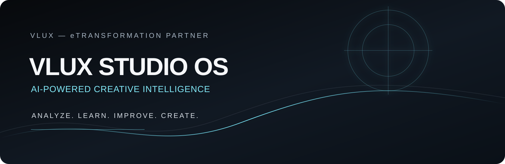
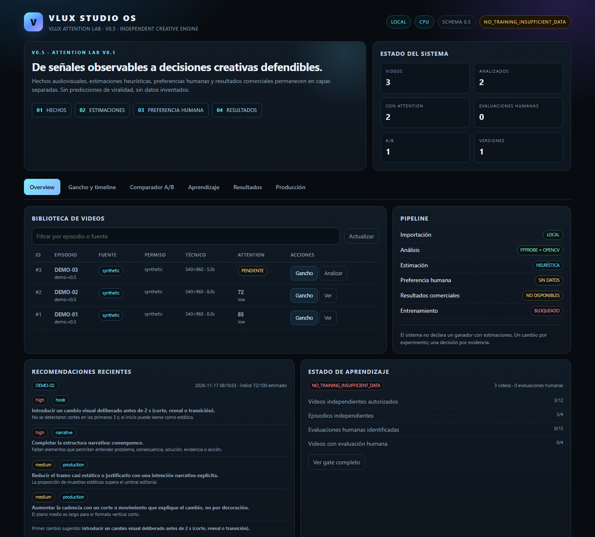
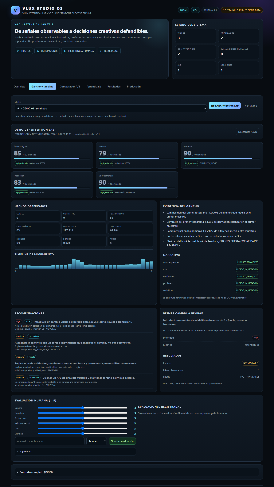
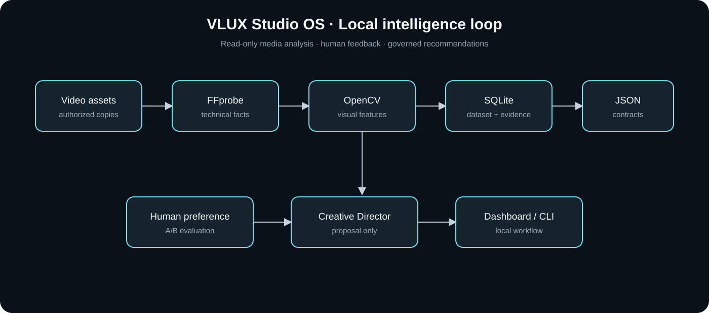

# VLUX Studio OS

**Local creative intelligence for business-focused video decisions.**

<p>
  <a href="https://vlux.com.mx">VLUX — eTransformation Partner</a> ·
  <a href="README.es.md">Leer en español</a>
</p>



VLUX Studio OS is a local-first Python system for analyzing authorized video, separating observable facts from heuristic estimates, capturing human judgment, comparing creative versions, and turning all of it into reviewable production decisions.

V0.5 introduces the **VLUX Attention Lab V0.1**: a deterministic, CPU-only creative analysis layer that explains its evidence, states its limitations, and refuses to treat likes as leads, sales, or scientific proof of virality.

> **Current training state**
>
> ```text
> NO_TRAINING_INSUFFICIENT_DATA
> ```
>
> This is intentional. No model has been trained, promoted, or commercially validated.

## What is new in V0.6

- **Creative Feedback Loop** — video → analysis → recommendations → correction brief → new version → comparison → feedback → future learning.
- **Versioned V0.6 contracts** — creative review, visual defects, recommended changes, production brief, episode version, human approval, human evaluation, performance record and performance comparison.
- **Actionable recommendations** — every change carries episode, timestamp, detected problem, evidence, estimated impact, proposed solution, priority, suggested tool and acceptance criterion; estimates are marked `ESTIMATE_ONLY` and never presented as results.
- **Production handoff** — proposal-only briefs (`auto_apply: false`, `write_into_agent_workspace: false`) with explicit import paths, SHA-256 hashes and permissions.
- **Episode versions** — immutable in practice (`NEVER_OVERWRITE`), integrity verified by SHA-256, activation/rollback scoped to comparison state.
- **Performance tracking per version** — missing metrics stay missing, zeros stay zero, likes are not leads.

## What is new in V0.5

- **Attention Lab** — hook, narrative, production, commercial-value and results layers with explicit confidence, coverage and limitations.
- **Four-layer A/B comparison** — observed facts, heuristic estimates, human preferences and real commercial results are never merged into a single score.
- **Human evaluation ledger** — identified 1–5 evaluations; anonymous and AI-assisted inputs are stored but excluded from the human layer and the training gate.
- **Dataset Registry and Training Gate** — training stays blocked until legitimate videos, labels, commercial records and an episode-level holdout exist.
- **Model Registry and rollback** — experiments, candidate metrics, named-human promotion and reversible activation.
- **Production adapters** — a local JSON `manifest` and a CPU-only `ffmpeg_animatic` placeholder; no GPU, no model weights, no external paid service.
- **Expanded local dashboard** — library, hook/timeline, A/B, evaluations, learning state, commercial results, production versions and recent recommendations.
- **Pilot run** — EP011 compared with EP021 using authorized local copies. The full public-safe report is [`docs/V05_PILOT.md`](docs/V05_PILOT.md).

## Why it exists

Companies publish constantly but often cannot explain why one piece earns attention, saves, conversations or commercial interest while another does not. Views alone do not explain business value.

```text
AUTHORIZED VIDEO
   → OBSERVED FACTS
   → HEURISTIC ESTIMATES
   → HUMAN PREFERENCE
   → COMMERCIAL RESULTS
   → ONE REVIEWABLE RECOMMENDATION
```

The product does **not** claim to generate complete videos automatically, predict virality, or replace human review.

## Product preview

The screenshots below are real captures of the V0.5 dashboard running on **synthetic demo data only** (`DEMO-01`, `DEMO-02`, `DEMO-03`). No client media, private metrics, or production database is shown.



*Overview: library, pipeline state, training gate, recent recommendations and commercial status.*



*Attention Lab: estimated scores, observed timeline facts, evidence, limitations and human evaluation form.*

## The pilot: EP011 vs EP021

Two authorized local copies were analyzed with FFprobe/OpenCV. The comparison is a **benchmark between different episodes**, not a controlled experiment; the topics, hooks and visual treatments differ, so no causal claim is possible.

| Observed fact | EP011 | EP021 |
| --- | ---: | ---: |
| Duration | 22.67 s | 22.87 s |
| Cuts detected | 11 | 4 |
| Cuts before 3 s | 1 | 0 |
| Average shot | 1.89 s | 4.57 s |
| Motion, full video | 12.12 | 5.95 |
| Mean brightness (0–255) | 81.76 | 50.06 |
| Mean contrast (0–255) | 66.01 | 40.75 |
| Near-static samples | 5.2 % | 15.5 % |

| Heuristic estimate (0–100) | EP011 | EP021 | Confidence |
| --- | ---: | ---: | --- |
| Hook | 90 | 69 | medium |
| Narrative | 90 | 90 | low |
| Production | 84 | 78 | medium |
| Commercial value (message completeness) | 90 | 90 | low |
| Overall | 88 | 81 | low |

These are editorial estimates, not a trained model and not a virality prediction. “Commercial value” only means the metadata contains audience, problem, solution and CTA fields; it is not revenue.

The A/B contract returns:

```text
decision_status: HUMAN_REVIEW_AND_RESULTS_REQUIRED
human_preferences: NOT_AVAILABLE
commercial_results: NOT_COMPARABLE
automatic_winner: null
```

**No human preference is recorded yet.** AI-assisted visual notes are labeled non-human and excluded. The first proposed change is to add a deliberate visual change before 2 s in EP021, keep everything else constant, and measure 3-second retention when a real measurement exists. This is a proposal, not a result.

The videos themselves disclose their nature: EP011 is a conceptual 3D recreation, not Autodesk’s interface; EP021 is a simulated case with fictional data. The pilot copies use `authorized_analysis_only` and are deliberately training-ineligible. Media, contact sheets, databases and private reports remain local and git-ignored.

## Architecture




```text
authorized media
   → FFprobe / OpenCV facts
   → SQLite evidence store
   → Attention Lab estimates + human evaluations
   → layered A/B comparison
   → recommendations
   → Creative Director brief
   → production handoff (proposal)
   → episode version import
   → version comparison
   → human feedback
   → learning governance
```

The training branch is separate and gated:

```text
Dataset Registry → Training Gate → Experiment → Evaluation → Model Registry → Manual promotion
```

There is no cloud service, platform credential, GPU dependency, model-weight bundle, render queue, or write integration with VLUX Video OS in this repository.

More detail: [`docs/ARCHITECTURE.md`](docs/ARCHITECTURE.md).

## Engineering practices

- modular components with explicit ownership;
- versioned SQLite schema (`0.6`) and versioned JSON contracts;
- SHA-256 file hashing and duplicate rejection;
- read-only treatment of source media;
- separate tables for assets, publications, platform metrics and commercial records;
- provenance and measurement date on every observation;
- human-in-the-loop labels with named evaluators;
- AI-assisted and anonymous inputs excluded from the human gate;
- episode-level holdout to reduce leakage;
- deterministic seeds, local experiments and a model registry;
- CPU-first execution;
- automated unit, contract and end-to-end tests;
- no automatic model promotion;
- rollback-preserving versions;
- no credentials or platform API tokens in the repository.

See [`docs/ENGINEERING_PRACTICES.md`](docs/ENGINEERING_PRACTICES.md) and [`docs/ML_METHODOLOGY.md`](docs/ML_METHODOLOGY.md).

## MSA-VLUX and coordination

Development follows **MSA-VLUX 6.0.0**: verifiable atoms, explicit ownership, contracts and handoffs, evidence before claims, validation before completion, a local integrity ledger, and proposals instead of autonomous production changes.

The project also applies coordination principles inspired by Concord: component responsibility, conflict awareness, evidence and handoff discipline. Concord did not execute this repository directly.

## Machine-learning strategy

The learning path is deliberately conservative:

1. collect audiovisual evidence from authorized assets;
2. collect identified human evaluations and pairwise preferences;
3. attach verified platform and commercial records;
4. compare a rules baseline;
5. train a lightweight candidate only when the gate passes;
6. hold out complete episodes or campaigns;
7. review metrics and limitations;
8. promote manually with a named human approver;
9. keep rollback available.

Current gate thresholds (`learning-gate.v0.1`):

| Requirement | Minimum |
| --- | ---: |
| Eligible authorized videos | 12 |
| Independent episodes | 4 |
| Identified human evaluations | 12 |
| Videos with human evaluation | 4 |
| Legitimate commercial records | 5 |
| Label classes | 2 |
| Episodes with labels | 2 |
| Holdout design | complete episode |

The real pilot reports `eligible_videos: 0` because the authorized copies are `authorized_analysis_only`. Training remains `NO_TRAINING_INSUFFICIENT_DATA`, not a failure state and not a hidden claim.

## Creative strategy

VLUX stories are organized around business value rather than software features:

```text
BUSINESS PROBLEM
→ REAL OPERATIONAL OR ECONOMIC CONSEQUENCE
→ TECHNOLOGICAL SOLUTION
→ BUSINESS BENEFIT
→ CALL TO ACTION
```

The Creative Director produces reviewable proposals for industrial topics such as CAD/ERP handoffs, quality traceability, manufacturing data, product engineering and automation. Every output is marked `PROPOSAL_ONLY` and never presented as a customer result.

See [`docs/CREATIVE_STRATEGY.md`](docs/CREATIVE_STRATEGY.md).

## Reference data: EP011

- **Topic:** Autodesk Fusion / Product Engineering
- **Platform:** Instagram
- **Provenance:** `USER_PROVIDED_SCREENSHOT`
- **Measurement date:** `UNKNOWN`
- **API verification:** not performed

| Metric | Value |
|---|---:|
| Views | 5,468 |
| Viewers | 4,389 |
| Average watch time | 10 seconds |
| Likes | 176 |
| Comments | 25 |
| Shares | 51 |
| Saves | 125 |
| New followers | 23 |
| Profile visits | 11 |

These are reference observations, not causal proof. Leads and revenue are **not available**. In V0.5 the EP011 publication is linked to the episode rather than a specific file version; the A/B contract states this explicitly with `match_basis: episode`. The authorized pilot copy is a late revision, so platform metrics may not correspond exactly to it.

See [`WHY_EP011_WORKED.md`](WHY_EP011_WORKED.md), [`docs/RESULTS.md`](docs/RESULTS.md) and [`docs/V05_PILOT.md`](docs/V05_PILOT.md).

## Quick start on Windows

```powershell
git clone https://github.com/lilpne25-ui/VLUX-Studio-OS.git
cd VLUX-Studio-OS
.\start.ps1
```

Dashboard: <http://127.0.0.1:8765>

Run verification:

```powershell
.\verify.ps1
```

The launcher creates a local `.venv` with system packages, checks FFmpeg/FFprobe and SQLite, and does not start Blender or use a GPU.

### Useful V0.6 commands

```powershell
python -m vlux_ci.cli creative-review <video_id>
python -m vlux_ci.cli creative-defects <video_id>
python -m vlux_ci.cli creative-changes <video_id>
python -m vlux_ci.cli review-export --review-key <key> --output-dir <dir>
python -m vlux_ci.cli brief-create --change-key <key> --target-version-label <label>
python -m vlux_ci.cli brief-export --brief-key <key> --output-dir <dir>
python -m vlux_ci.cli version-import <file> --episode <EP> --permission <synthetic|authorized|owned|public_domain|authorized_analysis_only>
python -m vlux_ci.cli version-import-contract <contract.json>
python -m vlux_ci.cli version-approve --subject-type recommended_change --subject-key <key> --decision APPROVED --evaluator <named>
python -m vlux_ci.cli version-evaluate --version-key <key> --evaluator <named> --preference B --compared-version-key <key>
python -m vlux_ci.cli performance-record --version-key <key> --platform Instagram --metrics '{"likes":176,"retention_3s":null,"qualified_leads":null}'
python -m vlux_ci.cli version-compare --a <version_a> --b <version_b> --platform Instagram
python -m vlux_ci.cli version-integrity --version-key <key>
python -m vlux_ci.cli versions-list --episode EP021
python -m vlux_ci.cli loop-status
```

### Useful V0.5 commands

```powershell
# Analyze one imported video
python -m vlux_ci.cli attention 1

# Record an identified human evaluation (1-5)
python -m vlux_ci.cli evaluate 1 --evaluator reviewer-name --provenance human `
  --hook 4 --narrative 4 --production 4 --commercial 3 --cta 4 --clarity 4

# Compare two videos without declaring an automatic winner
python -m vlux_ci.cli ab --a 1 --b 2

# Inspect the gate, register a dataset, attempt gated training
python -m vlux_ci.cli learning-status
python -m vlux_ci.cli dataset-register
python -m vlux_ci.cli train-gated --artifacts artifacts

# Plan, render, activate and roll back a local production version
python -m vlux_ci.cli production-plan --brief brief.json --adapter manifest
python -m vlux_ci.cli production-render <version_key>
python -m vlux_ci.cli production-activate <version_key>
python -m vlux_ci.cli production-rollback <version_key>
```

Validate the public contract schemas against local exports:

```powershell
python scripts\validate_contracts.py --defaults
```

Contract versions, producers and invariants are listed in [`contracts/README.md`](contracts/README.md).

## Project structure

```text
vlux_ci/                 application modules
  attention.py           Attention Lab contract and heuristics
  ab.py                  layered A/B comparison
  learning.py            dataset registry, training gate, model registry
  production.py          local production adapters and versions
  creative_loop.py       V0.6 Creative Feedback Loop
tests/                   unit, persistence and contract tests
scripts/                 demo, validation and end-to-end verification
contracts/               versioned JSON schemas
docs/                    public architecture, methodology and pilot report
examples/                synthetic/public-safe input examples
start.ps1                Windows launcher
verify.ps1               verification entry point
```

Private runtime data is intentionally excluded: SQLite databases, reports, artifacts, review media, synthetic runs, logs, caches, virtual environments and MSA ledger state.

## Roadmap

### Delivered

- V0.1 — dataset foundation;
- V0.2 — Creative Intelligence and commercial data model;
- V0.3 — functional local dashboard and end-to-end workflow;
- V0.4 — platform-separated commercial analytics and EP025 proposal evaluation;
- V0.5 — Attention Lab, layered A/B, dataset registry, training gate, model registry and local production versions.
- V0.6 — Creative Feedback Loop: versioned contracts, actionable recommendations, production handoff, episode-version import, version comparison, human evaluation, performance records and loop dashboard/CLI.

### Planned

- record identified human evaluations for real episodes;
- attach verified commercial outcomes with dates and provenance;
- run one-variable creative experiments with real measurement;
- expand the authorized dataset until the training gate can pass;
- validate a preference model with an independent episode holdout;
- integrate recommendations with VLUX Video OS through versioned contracts.

Planned work is not presented as implemented capability.

## Status and limitations

**Works today:** local dashboard and CLI, authorized MP4 copy/import, FFprobe/OpenCV facts, Attention Lab estimates with evidence, identified human evaluations, layered A/B comparison, dataset registry, blocked training gate, local production manifests and CPU animatics, version activation/rollback, JSON contracts, persistence and automated verification.

**Still requires evidence:** human preference data for real episodes, verified commercial outcomes, enough independent authorized videos to pass the gate, OCR/ASR for on-screen text, and human approval of production recommendations.

**V0.6 status:** the Creative Feedback Loop is implemented and verified with synthetic media and authorized local copies; the training gate remains blocked and no commercial improvement was claimed.

**Explicitly not claimed:** scientific virality prediction, causal effects from observational data, trained-model accuracy, customer results, revenue, or successful automatic video generation.

## About VLUX

**VLUX — eTransformation Partner**

> “No adaptamos tu empresa al software. Adaptamos la tecnología a la forma en que realmente opera tu empresa.”

VLUX develops software, automation and artificial intelligence solutions for real operational problems.

- Website: <https://vlux.com.mx>
- GitHub: <https://github.com/lilpne25-ui>

No additional social profiles are listed here because they were not independently confirmed during this release.

## License

No open-source license has been assigned. All rights remain with VLUX and the project owner. Do not assume permission to copy, redistribute, or use this software commercially.
