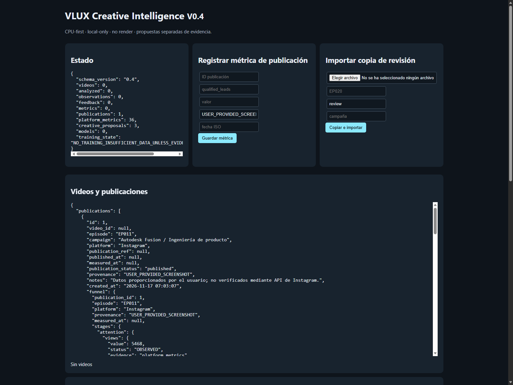
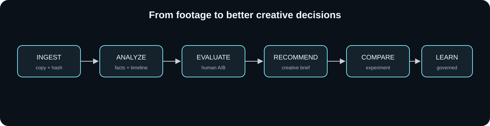

# VLUX Studio OS

**AI-powered creative intelligence for business-focused video decisions.**

<p>
  <a href="https://vlux.com.mx">VLUX — eTransformation Partner</a> ·
  <a href="README.es.md">Leer en español</a>
</p>


VLUX Studio OS is a local-first platform for analyzing video, organizing evidence, capturing human preferences, and turning creative observations into better production decisions.

It does **not** claim to generate complete videos automatically. The current product helps a team understand what is observable, what is only a hypothesis, and what should be tested next.

## Why it exists

Companies publish content constantly, but often cannot explain why one piece earns attention, saves, conversations, or commercial interest while another does not. Views alone do not explain business value.

VLUX Studio OS builds a traceable loop:

```text
VIDEO → ANALYSIS → HUMAN FEEDBACK → CREATIVE INTELLIGENCE
      → RECOMMENDATIONS → BETTER CREATIVE DECISIONS
```

## Product preview

The screenshot below is a real capture of the local V0.4 dashboard, with local project data and no customer files.



The dashboard supports:

- importing an authorized local copy of an MP4;
- technical and visual analysis with FFprobe and OpenCV;
- timestamped observations and timeline samples;
- A/B preference capture with criteria and confidence;
- publication and platform metric records;
- Creative Director proposals;
- JSON export for future VLUX Video OS integration.

## Architecture




The verified V0.4 stack is intentionally small:

- **Python** — application and CLI;
- **SQLite** — local, versioned persistence;
- **FFmpeg / FFprobe** — media probing and silence detection;
- **OpenCV** — CPU-first visual features;
- **NumPy** — lightweight model path when data is sufficient;
- **HTTP dashboard** — local workflow;
- **JSON contracts** — decoupled integration artifacts.

More detail: [`docs/ARCHITECTURE.md`](docs/ARCHITECTURE.md).

## Engineering practices

- modular components with explicit ownership;
- versioned schemas and JSON contracts;
- SHA-256 file hashing and duplicate detection;
- read-only treatment of source media;
- separation of assets, publications, and platform metrics;
- human-in-the-loop preference learning;
- episode/campaign holdout to reduce leakage;
- reproducible seeds and local model registry;
- CPU-first execution;
- automated unit and end-to-end tests;
- no automatic model promotion;
- rollback-preserving artifacts;
- no credentials or platform API tokens in the repository.

See [`docs/ENGINEERING_PRACTICES.md`](docs/ENGINEERING_PRACTICES.md).

## MSA-VLUX and coordination

Development follows **MSA-VLUX 6.0.0**:

- work in verifiable atoms;
- explicit ownership;
- contracts and handoffs;
- evidence before claims;
- validation before completion;
- a local integrity ledger;
- proposals instead of autonomous production changes.

The project also applies coordination principles inspired by Concord: component responsibility, conflict awareness, evidence, and handoff discipline. Concord did not execute this repository directly.

## Machine-learning strategy

The learning path is deliberately conservative:

1. collect audiovisual evidence;
2. collect human A/B preferences;
3. attach authorized platform and commercial metrics;
4. compare a rules baseline;
5. train a lightweight candidate only when data supports it;
6. hold out complete episodes or campaigns;
7. review metrics and limitations;
8. promote manually, with rollback available.

Current status:

```text
NO_TRAINING_INSUFFICIENT_DATA
```

There is no commercially validated model in this repository. No accuracy or business uplift is claimed. This state is intentional until independent episodes, human labels, and verified commercial outcomes are available.

## Creative strategy

VLUX stories are organized around business value rather than software features:

```text
BUSINESS PROBLEM
→ REAL OPERATIONAL OR ECONOMIC CONSEQUENCE
→ TECHNOLOGICAL SOLUTION
→ BUSINESS BENEFIT
→ CALL TO ACTION
```

The Creative Director produces proposals for industrial topics such as CAD/ERP handoffs, quality traceability, manufacturing data, product engineering, and automation. Proposals are marked `PROPOSAL_ONLY` and never presented as customer results.

See [`docs/CREATIVE_STRATEGY.md`](docs/CREATIVE_STRATEGY.md).

## Reference data: EP011

- **Topic:** Autodesk Fusion / Product Engineering
- **Platform:** Instagram
- **Source:** `USER_PROVIDED_SCREENSHOT`
- **Measurement date:** `UNKNOWN`
- **API verification:** not performed

| Metric | Value |
|---|---:|
| Views | 5,468 |
| Viewers | 4,389 |
| Average watch time | 10 seconds |
| Likes | 176 |
| Comments | 25 |
| Shares | 51 |
| Saves | 125 |
| New followers | 23 |
| Profile visits | 11 |

These are reference observations, not causal proof. Leads and revenue are **not available**. The audiovisual asset was not available during the public-release preparation, so visual conclusions about EP011 remain pending.

See [`WHY_EP011_WORKED.md`](WHY_EP011_WORKED.md) and [`docs/RESULTS.md`](docs/RESULTS.md).

## Quick start on Windows

```powershell
git clone https://github.com/lilpne25-ui/VLUX-Studio-OS.git
cd VLUX-Studio-OS
.\start.ps1
```

Dashboard: <http://127.0.0.1:8765>

Run verification:

```powershell
.\verify.ps1
```

The launcher creates a local `.venv` with system packages, checks FFmpeg/FFprobe and SQLite, and does not start Blender or use a GPU.

## Project structure

```text
vlux_ci/                 application modules
tests/                   unit and analyzer tests
scripts/                 demo, activation and end-to-end verification
contracts/               versioned JSON schemas
docs/                    public architecture and practice docs
examples/                synthetic/public-safe input examples
start.ps1                Windows launcher
verify.ps1               verification entry point
```

Private runtime data is intentionally excluded: SQLite databases, reports, artifacts, review media, synthetic runs, logs, caches, virtual environments, and MSA ledger state.

## Roadmap

### Completed

- V0.1 — dataset foundation;
- V0.2 — Creative Intelligence and commercial data model;
- V0.3 — functional local dashboard and end-to-end workflow;
- V0.4 — platform-separated commercial analytics and EP025 proposal evaluation.

### Planned

- expand the authorized real-world dataset;
- validate a preference model with independent holdout;
- run controlled creative optimization experiments;
- integrate recommendations with VLUX Video OS;
- assist automated production without removing human approval.

## About VLUX

**VLUX — eTransformation Partner**

> “No adaptamos tu empresa al software. Adaptamos la tecnología a la forma en que realmente opera tu empresa.”

VLUX develops software, automation, and artificial intelligence solutions for real operational problems.

- Website: <https://vlux.com.mx>
- GitHub: <https://github.com/lilpne25-ui>

No additional social profiles are listed here because they were not independently confirmed during this release.

## Status and limitations

**Works today:** local dashboard, MP4 copy/import, FFprobe/OpenCV analysis, timestamped observations, A/B feedback, publication metrics, funnel summaries, Creative Director proposals, JSON contracts, persistence, and automated verification.

**Still requires evidence:** real EP011 media analysis, verified commercial outcomes, enough independent preference labels for ML, and human approval of production recommendations.

## License

No open-source license has been assigned. All rights remain with VLUX and the project owner. Do not assume permission to copy, redistribute, or use this software commercially.
